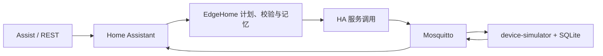

# EdgeHome Agent

EdgeHome Agent 是一个本地 Docker 智能家居演示项目：Home Assistant 是唯一服务调用边界，EdgeHome 只生成经白名单、安全规则和状态回读验证的固定计划。四个设备由独立 MQTT 模拟器和 SQLite 驱动，不是 Home Assistant Helper 假状态。



控制成功的唯一标准是：模拟器通过 MQTT 上报目标状态，且 Home Assistant 回读验证通过。HTTP 200、服务返回或模型文字都不等于控制成功。

## 当前边界

- 已有本地 MQTT 验收：主灯、窗帘、空调、电视、动态观影、离家保护、故障恢复和重启恢复。
- 路由器与冰箱是受保护设备，离家场景不会关闭它们。
- 项目使用 Docker 数字设备模拟器；没有宣称控制真实物理设备。
- PR #12 保持 Draft。脚本通过只表示本地集成验证，不能替代独立外部验收。

## 1. 环境要求

- Windows 10/11 + Docker Desktop（Linux containers）；或 Linux + Docker Compose v2。
- 至少一个本地 GGUF 模型，建议 1B–3B、Q4/Q8。
- 首次配置 Home Assistant 时使用浏览器访问 `http://127.0.0.1:8123`。
- 验收脚本需要 Python 3.11+；首次运行 M1/M1.5 脚本时需 `python -m pip install paho-mqtt`。

先确认 Docker 已启动：

```powershell
docker version
```

## 2. 首次部署（Windows）

以下命令必须在仓库根目录执行：

```powershell
cd E:\code\znjj\EdgeHome_Agent

# 创建本机私有配置；此文件不应提交。
Copy-Item .\deployment\.env.example .\deployment\.env

# 生成可复用的 Home Assistant 演示 YAML；不会复制或修改 .storage。
python .\scripts\install_edgehome_demo.py --config-dir .\deployment\homeassistant

# 启动 Home Assistant、MQTT、设备模拟器、llama.cpp 和 EdgeHome 组件同步服务。
powershell.exe -NoProfile -ExecutionPolicy Bypass -File .\scripts\start_demo.ps1
```

编辑 `deployment/.env`，至少配置下面三项：

```dotenv
TZ=Asia/Shanghai
MODELS_DIR=E:/models
MODEL_PATH=/models/your-model-q4_k_m.gguf
MODEL_CONTEXT_SIZE=2048
```

说明：`MODELS_DIR` 是宿主机模型目录；`MODEL_PATH` 是容器内挂载后的路径。不要把长期访问令牌、密码或 API Key 写进 `.env`。

启动完成后检查容器：

```powershell
docker compose -f .\deployment\docker-compose.yml ps
powershell.exe -NoProfile -ExecutionPolicy Bypass -File .\scripts\healthcheck.ps1
```

预期端口：Home Assistant `8123`、llama.cpp `8080`、MQTT `1883`、模拟器管理 API `8090`。

## 3. Home Assistant 首次配置

这是首次部署唯一需要在页面完成的配置；不要复制其他电脑的 `deployment/homeassistant` 或 `.storage` 目录。

1. 打开 `http://127.0.0.1:8123`，创建本机管理员账户。
2. 在“设置 → 设备与服务”添加 **Local LLM**。
3. 后端选择 llama.cpp server，填写：主机 `llama-server`、端口 `8080`、API 路径 `/v1`。
4. 在该服务下添加 Conversation agent，并启用 EdgeHome 选项；将它设为默认 Assist agent。
5. 在个人资料“安全”创建长期访问令牌，仅在当前 PowerShell 窗口设置：

```powershell
$env:HA_TOKEN = '粘贴本机长期访问令牌'
```

6. 使用支持的 Home Assistant 配置流创建 MQTT 条目（可重复执行）：

```powershell
python .\scripts\configure_mqtt_integration.py --url http://127.0.0.1:8123 --broker mqtt --port 1883
```

设备模拟器会发布 MQTT Discovery。成功后应自动出现：

- `light.edgehome_living_room_main`
- `cover.edgehome_living_room_curtain`
- `climate.edgehome_living_room_ac`
- `switch.edgehome_living_room_tv`

无需手工创建这些实体。

### 3.1 录制与演示：EdgeHome 工作台

完成上述配置后，打开 [EdgeHome 工作台](http://127.0.0.1:8123/edgehome-workbench)。正常用户从右上角 **Assist** 输入指令；工作台将同屏展示：

- MQTT Discovery 设备的真实状态；
- Agent 最近一次记录的处理路径、结构化计划和逐步状态回读；
- 路由器、冰箱的受保护状态；
- 仅用于本地演示的“重置环境 / 注入窗帘卡住 / 清除窗帘故障”按钮。

这些按钮经 Home Assistant 调用本地 device-simulator 管理接口，便于演示故障回读；它们不是业务控制入口。工作台读取 `sensor.edgehome_last_execution`，因此模型回复、HTTP 200 或单独的 MQTT ACK 不会被展示为“已成功执行”。完整录制步骤见 [`competition_submission/07_演示视频脚本.md`](competition_submission/07_演示视频脚本.md)。

## 4. 日常启动、停止和重置

```powershell
# 日常启动
docker compose -f .\deployment\docker-compose.yml up -d

# 查看日志或服务状态
docker compose -f .\deployment\docker-compose.yml ps
docker compose -f .\deployment\docker-compose.yml logs --tail 100 home-assistant

# 停止（保留 SQLite 状态）
docker compose -f .\deployment\docker-compose.yml stop

# 重置演示设备和故障注入状态
powershell.exe -NoProfile -ExecutionPolicy Bypass -File .\scripts\reset_demo.ps1
```

`docker compose down -v` 会删除 Compose 管理的卷和网络，但不会清理绑定挂载在 `deployment/runtime/` 的本机数据。需要保留演示状态或验收证据时，不要使用该命令，也不要手动删除该目录。

## 5. 验收命令

所有 API 验收脚本都要求当前终端已设置 `HA_TOKEN`。一次只运行一个重启类脚本。

```powershell
# M1 / M1.5
python .\scripts\accept_m1_mqtt_light.py
python .\scripts\accept_m15_context.py

# M2–M8
python .\scripts\accept_m2_mqtt_curtain.py
python .\scripts\accept_m3_mqtt_climate.py
python .\scripts\verify_m3_climate_restart_matrix.py
python .\scripts\accept_m4_mqtt_tv.py
python .\scripts\accept_m5_mqtt_movie.py
python .\scripts\accept_m6_leaving_protection.py
python .\scripts\accept_m7_fault_recovery.py
python .\scripts\accept_m8_system_stability.py
```

M8 会依次重启 Home Assistant、MQTT 和模拟器，页面短暂不可访问是预期行为。原始证据写入 [`reports/acceptance`](reports/acceptance)，至少包含用户输入、`conversation_id`、执行计划、MQTT/模拟器事件、HA 前后状态和 Agent 最终回复。

## 6. 常见问题

|现象|处理方式|
|---|---|
|找不到 `scripts/*.ps1`|确认当前目录是 `E:\code\znjj\EdgeHome_Agent`，不是上层 `E:\code\znjj`。|
|`HA_TOKEN 未设置`|在同一个 PowerShell 窗口重新执行 `$env:HA_TOKEN = '...'`。|
|浏览器显示连接被拒绝|执行 `docker compose -f .\deployment\docker-compose.yml ps`，等待 `home-assistant` 为 `Up` 后刷新。|
|MQTT 实体未出现|确认 MQTT 配置流已执行；然后重启模拟器：`docker compose -f .\deployment\docker-compose.yml restart device-simulator`。|
|模型容器无法启动|检查 `.env` 的 `MODELS_DIR` 与 `MODEL_PATH` 是否分别是宿主机路径和容器路径。|
|验收脚本缺少 `paho.mqtt`|执行 `python -m pip install paho-mqtt` 后重试。|

## 7. 仓库结构与安全边界

|路径|用途|
|---|---|
|`custom_components/llama_conversation/edgehome/`|意图、实体白名单、计划、安全、回读、会话记忆。|
|`device_simulator/`|独立 MQTT 设备和 SQLite 状态。|
|`deployment/`|Compose、Mosquitto、可提交的演示 YAML 模板。|
|`scripts/`|初始化、健康检查、配置流和黑盒验收。|
|`reports/acceptance/`|脱敏验收证据。|

绝不提交 `deployment/.env`、`deployment/homeassistant/`、`deployment/runtime/`、模型、Token、浏览器会话或真实用户数据。更多设计和报告见 [`docs`](docs) 与 [`reports`](reports)。
