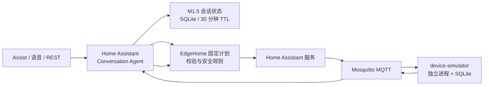

# EdgeHome Agent

EdgeHome Agent 是一个运行在本机 Docker 环境中的 Home Assistant 边缘智能项目。它以本地量化大模型为对话入口，以 Home Assistant 为唯一控制边界，并用 MQTT 驱动独立设备仿真器，验证“理解 → 决策 → 执行 → 状态回读”的闭环。

项目基于 [acon96/home-llm](https://github.com/acon96/home-llm) 扩展；本仓库新增的 EdgeHome 模块聚焦中文家庭控制、安全约束、端侧部署、可观测执行链路和独立 MQTT 设备仿真。

## 当前状态

| 模块 | 状态 | 说明 |
| --- | --- | --- |
| M1：MQTT 客厅主灯 | 待外部黑盒验收 | 已完成 Agent → HA → MQTT → 独立模拟器 → 状态回读闭环。 |
| M1.5：结构化会话记忆 | `READY_FOR_EXTERNAL_CONTEXT_ACCEPTANCE` | SQLite 持久化、30 分钟 TTL、会话隔离、失败不污染上下文和重启恢复已验证。 |
| M2：MQTT 窗帘 | 未开始 | 仅在 M1/M1.5 外部验收后启动。 |
| 物理设备接入 | 未声明 | 当前仅使用 Docker 数字设备仿真器。 |

> PR #12 保持 Draft，M1 尚未合并；请勿把脚本通过或仓库中的模拟实体表述为物理设备验收通过。

## 架构



控制成功的标准不是服务调用返回，而是 Home Assistant 回读到由 MQTT 模拟器上报的目标状态。任何验证失败都会报告失败，不写入“最近成功操作”。

## 快速开始（Windows + Docker Desktop）

1. 准备模型与配置。

```powershell
Copy-Item .\deployment\.env.example .\deployment\.env
```

编辑 `deployment/.env`，至少设置本机 GGUF 模型的 `MODEL_PATH`。不要把 Home Assistant 长期访问令牌写入 `.env` 或提交到 Git。

2. 启动服务。

```powershell
powershell.exe -NoProfile -ExecutionPolicy Bypass -File .\scripts\start_demo.ps1
```

打开 `http://127.0.0.1:8123` 完成 Home Assistant 初始化，并在 Local LLM 集成中使用：

```text
http://llama-server:8080/v1
```

3. 完成 MQTT 集成后，设置仅当前终端有效的令牌并运行检查。

```powershell
$env:HA_TOKEN = '<本机长期访问令牌>'
python .\scripts\configure_mqtt_integration.py --url http://127.0.0.1:8123 --broker mqtt --port 1883
powershell.exe -NoProfile -ExecutionPolicy Bypass -File .\scripts\healthcheck.ps1
```

详细部署步骤见 [部署说明](docs/deployment.md) 与 [MQTT 设备仿真说明](docs/MQTT_DEVICE_SIMULATOR.md)。

## 演示与验证

```powershell
# 重置虚拟家庭和独立 MQTT 主灯
powershell.exe -NoProfile -ExecutionPolicy Bypass -File .\scripts\reset_demo.ps1

# M1 闭环基础验证：成功控制 + ack_without_state_change
powershell.exe -NoProfile -ExecutionPolicy Bypass -File .\scripts\verify_mqtt_light.ps1

# M1.5 正式 Assist 入口验证：50% → 再暗一点 → 关掉吧 → 会话隔离
powershell.exe -NoProfile -ExecutionPolicy Bypass -File .\scripts\verify_context_memory.ps1

# 加入仅重启 Home Assistant 后的 SQLite 恢复验证
powershell.exe -NoProfile -ExecutionPolicy Bypass -File .\scripts\verify_context_memory.ps1 -RestartHomeAssistant
```

普通 Assist 对话会自动回传 `conversation_id`。开发者工具或一次性 REST 请求若未回传上一轮 ID，会被安全地视为新会话，并要求澄清设备，绝不会使用全局“上一设备”猜测。

## 仓库导航

| 路径 | 内容 |
| --- | --- |
| `custom_components/llama_conversation/edgehome/` | EdgeHome 决策、校验、执行、安全、知识、能耗与会话记忆代码。 |
| `device_simulator/` | MQTT 数字设备模拟器；目前包含客厅主灯。 |
| `deployment/` | Docker Compose、Mosquitto 配置、Home Assistant 运行配置模板。 |
| `scripts/` | 启动、重置、健康检查、MQTT 配置和端到端验证脚本。 |
| `tests/` | 单元测试与会话状态、隔离、过期、失败恢复测试。 |
| `docs/` | 技术设计、部署、性能与用户指南；见 [文档索引](docs/README.md)。 |
| `reports/` | 代码审计、执行证据与验收边界；见 [报告索引](reports/README.md)。 |
| `competition_submission/` | 比赛材料、演示脚本、图表和可复核数据。 |

## 关键文档

- [M1 MQTT 独立设备仿真](docs/MQTT_DEVICE_SIMULATOR.md)
- [M1.5 会话记忆设计](docs/EdgeHome%20Dialogue%20State.md)
- [会话链路审计](reports/CONTEXT_MEMORY_AUDIT.md)
- [M1.5 实施说明](reports/CONTEXT_MEMORY_IMPLEMENTATION.md)
- [M1.5 真实执行记录](reports/CONTEXT_MEMORY_REAL_EXECUTION.md)
- [M1.5 未验证边界](reports/CONTEXT_MEMORY_UNVERIFIED.md)
- [比赛材料入口](competition_submission/01_作品简介.md)

## 安全与仓库边界

- 不提交 `deployment/.env`、`deployment/homeassistant/`、`deployment/runtime/`、本地模型和数据库；
- 不提交 Home Assistant Token、密码、API Key、浏览器会话或账户数据；
- 可提交的真实验证材料只包含不含凭据的请求文本、会话 ID、设备状态、执行结果和脱敏日志；
- 受保护设备、计划校验与执行回读不能因演示或性能测试被绕过。

更多上游 Home LLM 能力、模型训练和第三方后端说明保留在 `docs/Setup.md`、`docs/Backend Configuration.md`、`data/` 与 `train/` 中。
